# 🎥 **Kino Aplikacija** 🎞️🍿
## 2019 👴 School project 

### Made with Windows Forms C# / nHibernate ORM - C# classes / SQL / ❤️  
___
 

### Mainscreen

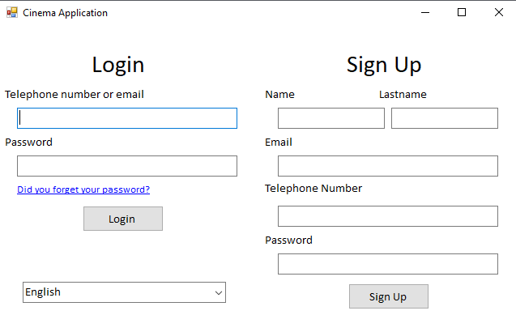</img>

### User view after login
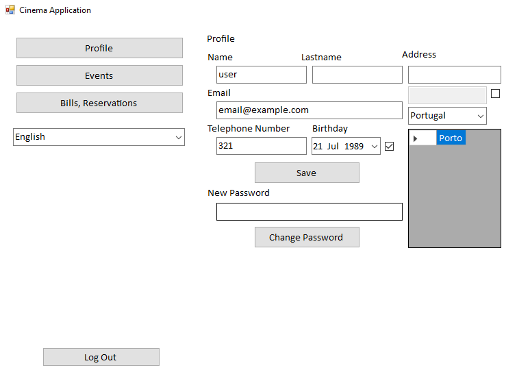</img>
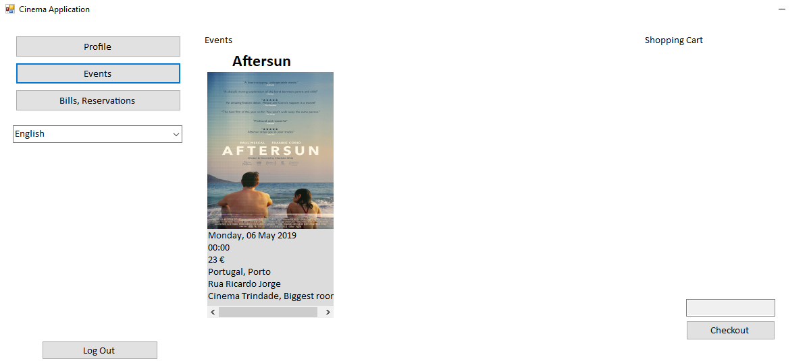</img>
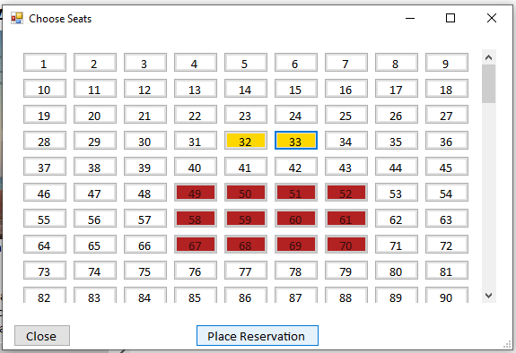</img>
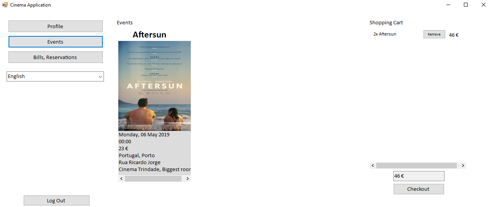</img>
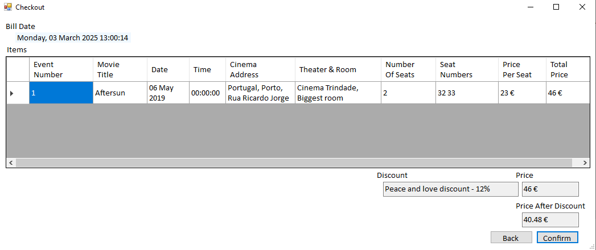</img>
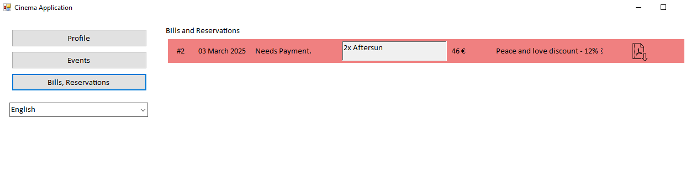</img>
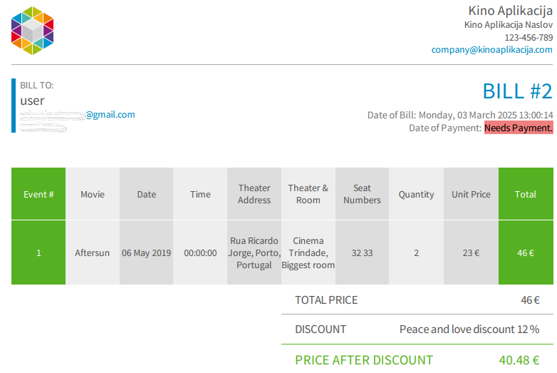</img>

### The User View is localized in 3 languages. Includes Email and exported Bills.

### Admin view after login.

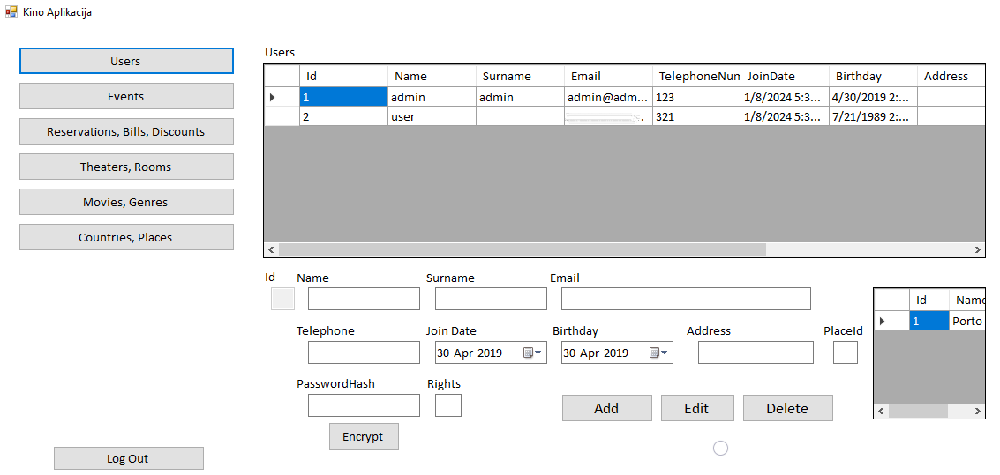</img>
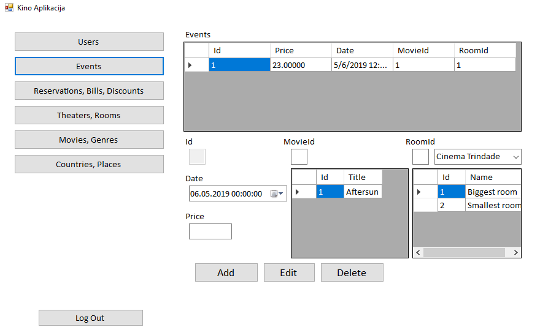</img>
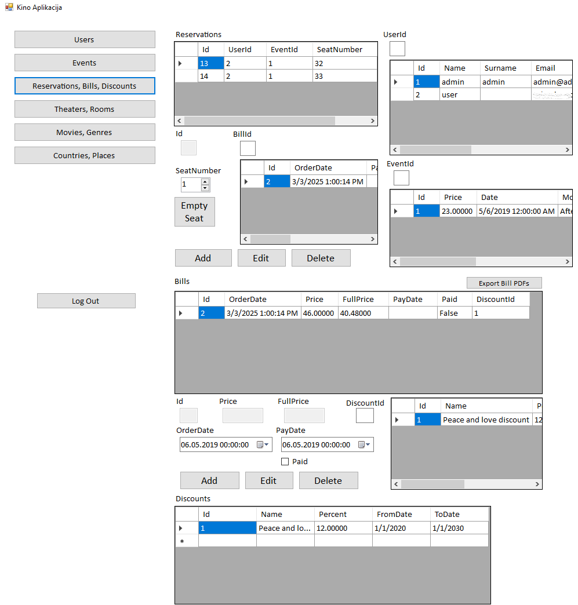</img>
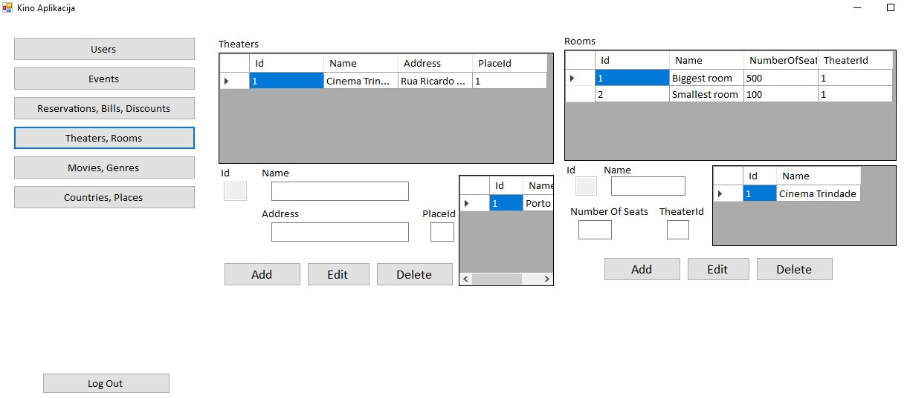</img>
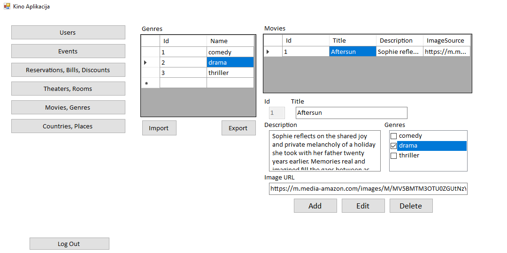</img>
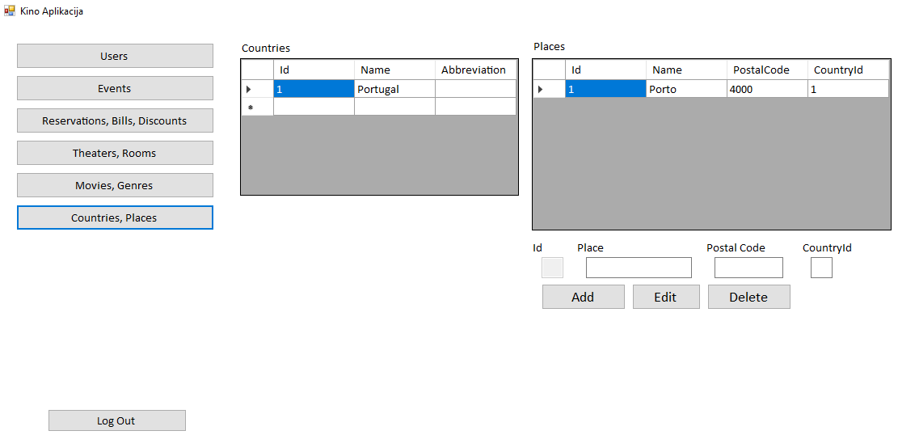</img>

## P.s.: UI's a bit 😱 ^^. I think I ran out of time to make it look pretty 😣